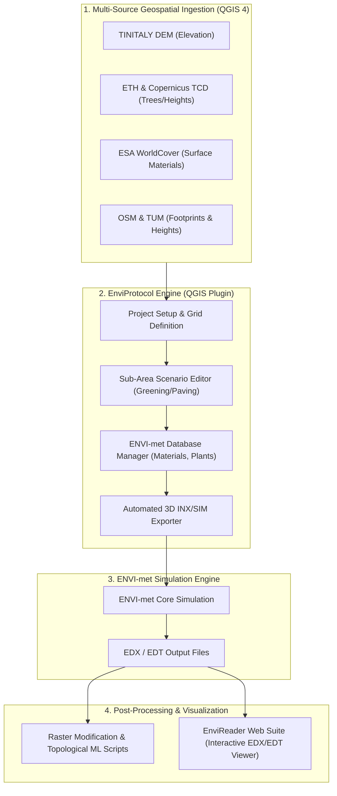

# ENVI-met Automation Protocol: Standardized Environmental Modeling & QGIS 4 Automation Pipeline

[](https://doi.org/10.5281/zenodo.14548213)
[](https://www.gnu.org/licenses/gpl-3.0)
[](https://qgis.org)
[](https://python.org)
[](https://github.com/grazianoEnzoMarchesani/EnviReader)

---

## Abstract

The **ENVI-met Automation Protocol** is a comprehensive computational framework and **QGIS 4 Python plugin (`EnviProtocol`)** developed to standardize, automate, and scale microclimatic simulations with [ENVI-met](https://envi-met.com). Conceived within the research activities of the **LIFE A_GreeNET** project, the protocol overcomes traditional bottlenecks in environmental modeling: high manual overhead, disparate data sources, geometric inconsistency, and complex scenario comparisons.

By directly coupling open geospatial datasets with ENVI-met's 3D grid system, the protocol enables seamless acquisition, pre-processing, 3D sub-area scenario generation, and export. Post-simulation analysis and 3D/temporal visualization are integrated through the companion platform [**EnviReader**](https://github.com/grazianoEnzoMarchesani/EnviReader), establishing a complete end-to-end pipeline from raw GIS data to scientific microclimate assessment.

---

## Project Objectives

1. **Standardize Microclimatic Modeling Workflows**: Establish reproducible, geometrically consistent protocols for large-scale urban microclimate modeling.
2. **Automate Geospatial Data Ingestion**: Direct automated retrieval and reprojection of digital elevation models (TINITALY DEM), tree canopy cover and heights (ETH Global Canopy, Copernicus TCD), land use (ESA WorldCover), and building footprints/attributes (OSM, TUM).
3. **Streamline 3D Model Construction**: Eliminate manual grid modeling errors by programmatically generating ENVI-met `.INX`, `.SIM`, and database files.
4. **Facilitate Sub-Area Interventions**: Provide interactive QGIS tools to delineate and customize design scenarios (urban greening, cool pavements, building renovations) with immediate parameter recalculation.
5. **Seamless Data Exploration with EnviReader**: Bridge raw simulation outputs (`.EDX` / `.EDT`) with modern web-based inspection, comparative analysis, and high-performance charting.
6. **Integrate Raster Diagnostic & Machine Learning Tools**: Offer modular post-processing scripts for topological clustering, zonal statistics, and predictive microclimate feature extraction.

---

## Architecture & Ecosystem



---

## Key Features

### 1. Automated Geospatial Data Retrieval
- Connects directly to open data providers via threaded background tasks:
  - **TINITALY**: High-resolution Digital Elevation Models.
  - **ETH Global Canopy Height & Copernicus Tree Cover Density (TCD)**: Precise vegetative canopy layers.
  - **ESA WorldCover & Copernicus High-Resolution Layers (HRL)**: Surface cover and soil classification.
  - **OpenStreetMap (OSM) & TUM 3D Buildings**: Footprints, heights, and geometric classification.

### 2. Interactive Scenario & Sub-Area Customization
- Intuitive QGIS canvas tool for defining targeted intervention areas.
- Parametric adjustment of:
  - **Building Customization**: Wall/roof materials, albedo modifications, thermal properties.
  - **Vegetation Insertion**: Crown dimensions, Leaf Area Index (LAI), root depth, seasonal plant profiles.
  - **Pavements & Roads**: Permeable surfaces, asphalt types, albedo enhancements.

### 3. Native ENVI-met Exporter
- Generates fully compliant ENVI-met grid models (`.INX`) and configuration files (`.SIM`).
- Programmatic mapping of GIS attributes to internal ENVI-met material and plant databases.
- Automatic boundary grid telescoping and nested grid positioning.

### 4. Integration with EnviReader for Simulation Data Analysis
To inspect, chart, and communicate simulation results, the pipeline connects with [**EnviReader**](https://github.com/grazianoEnzoMarchesani/EnviReader) ([Live Web App](https://envireader.altervista.org)):
- **Zero-upload local processing**: Read massive `.EDX`/`.EDT` binary files directly within the browser without uploading sensitive data to external servers.
- **Dynamic 2D/3D & Temporal Charts**: ECharts integration for temperature profiles, mean radiant temperature ($T_{mrt}$), PMV/PET comfort indices, wind vectors, and humidity.
- **Scenario Differential Comparison**: Direct pixel-by-pixel differential heatmaps (e.g., baseline vs. climate mitigation scenario).

### 5. Advanced Raster & Machine Learning Toolkit
The repository includes automated spatial analysis scripts:
- Layer grouping and automated import verification.
- Virtual Raster (VRT) topological clustering and zonal statistics.
- Training feature extraction for machine learning diagnostics and microclimatic correlation models.

---

## Project Structure

```text
EnviMet-automation-Protocol/
├── EnviMet-automation-Protocol-plugin/   # Core QGIS 4 Python Plugin
│   ├── core/                            # Async downloaders, managers, ENVI-met DB
│   ├── ui/                              # QGIS UI dialogs, dashboard, canvas tools
│   ├── EnviReader/                      # Embedded standalone EnviReader web suite
│   ├── script modifica raster envimet/  # Raster analysis, VRT clustering & ML scripts
│   ├── metadata.txt                     # QGIS plugin descriptor (v2.0.0)
│   └── main.py                          # Plugin entry point
├── attachment/                          # Documentation assets and diagrams
├── Protocollo di automazione ENVI-met.md # Comprehensive Italian protocol documentation
├── CITATION.cff                         # Academic Citation File Format metadata
├── .zenodo.json                         # Zenodo release integration metadata
└── README.md                            # Main project overview
```

---

## Installation & Setup

### Requirements
- **QGIS**: Version 4.0 or higher
- **Python**: 3.12+ (embedded in QGIS 4)
- **Dependencies**: `requests`, `numpy`, `scipy` (installed automatically or via plugin prompt)

### Installing the QGIS Plugin
1. Download or clone this repository.
2. Copy the folder `EnviMet-automation-Protocol-plugin` to your QGIS 4 plugins directory:
   - **Windows**: `%APPDATA%\QGIS\QGIS4\profiles\<your_profile>\python\plugins\`
   - **Linux**: `~/.local/share/QGIS/QGIS4/profiles/<your_profile>/python/plugins/`
   - **macOS**: `~/Library/Application Support/QGIS/QGIS4/profiles/<your_profile>/python/plugins/`
3. Launch QGIS, open **Plugins > Manage and Install Plugins...**, and activate **EnviProtocol**.

---

## Citation & Zenodo

If you use this protocol, the QGIS plugin, or associated scripts in your scientific research or municipal projects, please cite:

```bibtex
@software{marchesani_envimet_protocol_2026,
  author       = {Marchesani, Graziano Enzo},
  title        = {EnviMet-automation-Protocol: Standardized Environmental Modeling Automation and QGIS Plugin},
  month        = oct,
  year         = 2026,
  publisher    = {Zenodo},
  version      = {2.0.0},
  doi          = {10.5281/zenodo.14548213},
  url          = {https://doi.org/10.5281/zenodo.14548213}
}
```

- **Zenodo Concept DOI (all versions)**: [10.5281/zenodo.14548213](https://doi.org/10.5281/zenodo.14548213)
- **Previous Release (v0.2)**: [10.5281/zenodo.14548215](https://doi.org/10.5281/zenodo.14548215)

---

## Author & Acknowledgments

* **Author**: **Graziano Enzo Marchesani**  
  *Affiliation*: Università di Camerino  
  *ORCID*: [0000-0002-4723-5099](https://orcid.org/0000-0002-4723-5099)  
  *Email*: [grazianoenzomarchesani@unicam.it](mailto:grazianoenzomarchesani@unicam.it)  
  *GitHub*: [@grazianoEnzoMarchesani](https://github.com/grazianoEnzoMarchesani)

* **Related Projects**:
  * [**EnviReader**](https://github.com/grazianoEnzoMarchesani/EnviReader) — High-performance web-based visualization and analysis of ENVI-met EDX/EDT simulation data.
  * Developed in the context of the **LIFE A_GreeNET** Project.

---

## License

This project is licensed under the **GNU General Public License v3.0 or later** (GPL-3.0-or-later) - see the [LICENSE](LICENSE) file for details.
